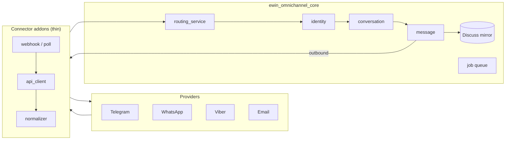

# EWIN Inbox

**Omnichannel customer inbox for Odoo 18.** One place for your team to receive and answer customer messages from Telegram, WhatsApp, Viber, Email and website Live Chat — threaded into Odoo Discuss, tied to `res.partner`, with routing, delivery status, canned replies and reporting.

  

---

## Why

Support teams juggle a dozen apps. EWIN Inbox pulls every channel into a single Odoo-native inbox: an agent sees one conversation list, replies in one composer, and every message is a first-class Odoo record — searchable, assignable, reportable, and linked to the customer's partner.

## Features

- **Unified inbox** — conversations from all channels in one list, assignable to agents and teams.
- **Two-way messaging** — inbound and outbound text plus media (images, documents, audio/voice, video, stickers).
- **Discuss mirror** — every conversation is mirrored into an Odoo Discuss channel, so agents get native notifications, mentions and unread counts.
- **Contacts** — senders are matched to / created as `res.partner`; conversations carry the partner link.
- **Routing & queue** — inbound routing service, a retry job queue for outbound, first-response metrics.
- **Delivery status** — sent / delivered / read / failed reflected on each message (where the channel supports it).
- **Canned replies & templates** — reusable snippets with `{{name}}` placeholders; WhatsApp HSM templates synced from Meta.
- **Reporting** — conversation and message analytics (pivot / graph).
- **Idempotent & resilient** — provider events are de-duplicated; failed sends fall back to a retry queue; webhooks never 500.

## Channels

| Channel | Module | Transport | Highlights |
|---|---|---|---|
| Telegram | `ewin_omnichannel_telegram` | Bot webhook | Full media, instant sync send |
| WhatsApp Business | `ewin_omnichannel_whatsapp` | Meta Cloud API (Graph) | Media, delivery status, HSM templates, 24h-window handling |
| Viber | `ewin_omnichannel_viber` | Bot webhook | Text + media |
| Email | `ewin_omnichannel_email` | IMAP poll + SMTP | RFC-2822 threading, TLS enforced |
| Live Chat | `ewin_omnichannel_livechat` | In-process (no webhook) | Bridges website Live Chat; hybrid partner/visitor/guest identity |

Each connector is a thin addon over a shared core — adding a channel means writing an API client, a payload normalizer and a webhook/poll entry point, not re-implementing the inbox.

## Architecture



- **`ewin_omnichannel_core`** owns the domain: channels, accounts, identities, conversations, messages, the routing service, the retry job queue, the Discuss mirror, reporting and canned templates. It knows nothing about any specific provider.
- **Connector addons** implement one abstract contract (`omnichannel.connector`): parse an inbound provider event into a universal shape, and send an outbound message. Inbound always flows through `routing_service.process_event`; outbound always flows through `connector.send_message`.

## Install

These are standard Odoo 18 addons. Put the modules under `addons/` on your Odoo `addons_path`, then install the core plus the channels you need (developer mode → Apps, or CLI):

```bash
odoo -d <db> -i ewin_omnichannel_core,ewin_omnichannel_whatsapp --stop-after-init
```

> Menus that read `omnichannel.*` are visible only to users in an EWIN Inbox security group. Grant yourself the **EWIN Inbox / Administrator** group after install.

## Configure a channel

Open **EWIN Inbox → Configuration → Accounts**, create an account, pick the channel, and fill its credentials. Each connector's own `README.md` documents the provider-side setup (bot token, Meta app + webhook, IMAP/SMTP, …). WhatsApp, for example, needs a Meta Cloud API access token, phone number ID, WABA ID and App Secret, plus the webhook URL `…/omnichannel/webhook/whatsapp/<webhook_uuid>` registered in the Meta app.

## Development & tests

Each module ships a test suite. Run one against a test database:

```bash
# ‑u to upgrade, ‑i to install first
odoo -d <test-db> -u ewin_omnichannel_whatsapp --test-enable --stop-after-init \
  --http-port=8269 --test-tags /ewin_omnichannel_whatsapp
```

`--http-port=8269` avoids colliding with an already-running server on 8069. A green run ends with `0 failed, 0 error(s) of N tests`.

## Project layout

```
addons/
  ewin_omnichannel_core/        # shared domain + services + Discuss mirror + reporting
  ewin_omnichannel_telegram/    # Telegram bot connector
  ewin_omnichannel_whatsapp/    # WhatsApp Business (Meta Cloud API) connector
  ewin_omnichannel_viber/       # Viber bot connector
  ewin_omnichannel_email/       # Email (IMAP/SMTP) connector
  ewin_omnichannel_livechat/    # Website Live Chat connector (in-process, no webhook)
```

## Security notes

- Provider secrets (tokens, app secrets) are stored under an admin-only security group and never logged.
- Webhooks are authenticated per provider (e.g. WhatsApp validates the `X-Hub-Signature-256` HMAC over the raw body with the Meta App Secret, constant-time).
- Real secrets never live in the repo: provider credentials are entered in Odoo (under an admin-only group), and any local runtime config (`odoo.conf`, `.env`, certificates) is git-ignored.

## License

LGPL-3.0. See each addon's `__manifest__.py`.
