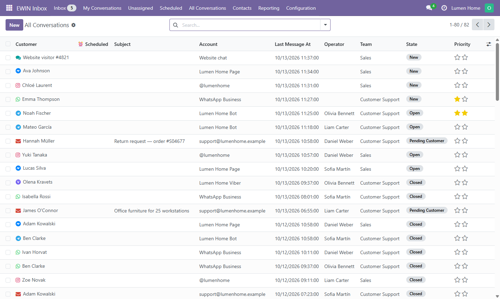
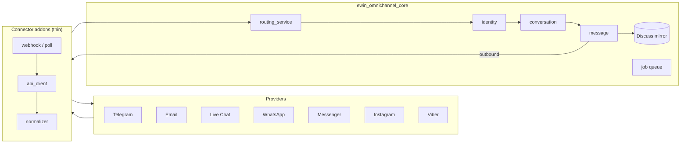

# EWIN Inbox

Open-source omnichannel customer inbox for Odoo 18.

Receive and answer customer messages from Telegram, Email, Live Chat,
WhatsApp, Messenger, Instagram and Viber in one Odoo-native interface.

Messages are linked to Odoo contacts and mirrored into Discuss, with agent
assignment, delivery statuses, canned replies, retries and reporting.

Developed and maintained by [EWIN.codes](https://ewin.codes).

  



## Features

- Unified inbox for all connected channels
- Two-way text and media messaging
- Odoo Discuss integration
- Contact matching with `res.partner`
- Agent and team assignment — replying takes an unassigned conversation
- Realtime thread and list updates, no manual reload
- Delivery and read statuses where supported
- Canned replies
- Scheduled replies — defer an answer to a chosen date and time; a counted tab
  above the chat holds the waiting replies as their own thread, and each can be
  rewritten in the composer, rescheduled, sent early or cancelled until it
  leaves
- Close reasons — optional or mandatory, from a configurable list
- Retry queue
- Reporting

## Channel status

| Channel | Status |
|---|---|
| Telegram | Tested |
| Email | Tested |
| Live Chat | Tested |
| WhatsApp | Unverified |
| Messenger | Tested |
| Instagram | Unverified |
| Viber | Unverified |

- **Tested** — manually verified using a real provider account.
- **Unverified** — implementation is complete but has not yet been tested
  against a live provider account.

## Installation

1. Clone the repository.
2. Add the repository path to the Odoo `addons_path`.
3. Update the Apps list.
4. Install EWIN Inbox.
5. Install the required channel connectors.
6. Grant the user the EWIN Inbox administrator role.

Or install from the command line — the core plus the channels you need:

```bash
odoo -d <db> -i ewin_omnichannel_core,ewin_omnichannel_telegram --stop-after-init
```

> Menus that read `omnichannel.*` are visible only to users in an EWIN Inbox
> security group. Grant yourself the **EWIN Inbox / Administrator** group after
> install.

## Requirements

- Odoo 18
- Public HTTPS endpoint for webhook-based connectors
- Provider accounts and API credentials for selected channels
- IMAP and SMTP credentials for Email

## Limitations

- WhatsApp and Instagram are subject to Meta API rules and messaging windows.
- Delivery and read statuses depend on provider capabilities.
- Unverified connectors should be tested in staging before production use.
- The module does not bypass provider verification or messaging restrictions.

## Support

For bug reports, use GitHub Issues.

For implementation, customization and commercial support:

info@ewin.codes

## License

Licensed under the GNU Lesser General Public License v3.0.
See [LICENSE](LICENSE).

Copyright © 2026 EWIN.codes

---

## Architecture

EWIN Inbox is a shared, channel-agnostic core plus one thin connector addon per
channel. Adding a channel means writing an API client, a payload normalizer and a
webhook/poll entry point — not re-implementing the inbox.



- **`ewin_omnichannel_core`** owns the domain: channels, accounts, identities,
  conversations, messages, the routing service, the retry job queue, the Discuss
  mirror, reporting and canned templates. It knows nothing about any specific
  provider.
- **Customer history.** A conversation can be linked to a contact and — with
  `ewin_omnichannel_crm` — to a CRM lead. Every message is then copied into that
  record's chatter as an internal note, live, so the customer's own history holds
  what was said on any channel. One lead carries as many conversations as the
  customer starts; unlinking removes exactly the copies linking created.
- **Connector addons** implement one abstract contract (`omnichannel.connector`):
  parse an inbound provider event into a universal shape, and send an outbound
  message. Inbound always flows through `routing_service.process_event`; outbound
  always flows through `connector.send_message`.

Each module documents its own setup, security model and limits — follow the
links below.

| Channel | Module | Transport |
|---|---|---|
| — | [`ewin_omnichannel_core`](ewin_omnichannel_core/README.md) | Shared domain, required by every connector |
| Telegram | [`ewin_omnichannel_telegram`](ewin_omnichannel_telegram/README.md) | Bot webhook |
| Email | [`ewin_omnichannel_email`](ewin_omnichannel_email/README.md) | IMAP poll + SMTP |
| Live Chat | [`ewin_omnichannel_livechat`](ewin_omnichannel_livechat/README.md) | In-process (no webhook) |
| WhatsApp | [`ewin_omnichannel_whatsapp`](ewin_omnichannel_whatsapp/README.md) | Meta Cloud API (Graph) |
| Messenger | [`ewin_omnichannel_messenger`](ewin_omnichannel_messenger/README.md) | Meta Graph API (Pages) |
| Instagram | [`ewin_omnichannel_instagram`](ewin_omnichannel_instagram/README.md) | Instagram Graph API (business login) |
| Viber | [`ewin_omnichannel_viber`](ewin_omnichannel_viber/README.md) | Bot webhook |

One module is not a channel:

| Module | What it adds |
|---|---|
| [`ewin_omnichannel_crm`](ewin_omnichannel_crm/README.md) | Links conversations to CRM leads and mirrors their texts into the lead's history |

All modules use Odoo model names in the `omnichannel.*` namespace (e.g.
`omnichannel.conversation`); only the Odoo *module* names carry the `ewin_` prefix.

## Repository layout

```
ewin_omnichannel_core/        # shared domain + services + Discuss mirror + reporting
ewin_omnichannel_telegram/    # Telegram bot connector
ewin_omnichannel_email/       # Email (IMAP/SMTP) connector
ewin_omnichannel_livechat/    # Website Live Chat connector (in-process, no webhook)
ewin_omnichannel_whatsapp/    # WhatsApp Business (Meta Cloud API) connector
ewin_omnichannel_messenger/   # Facebook Messenger (Pages) connector
ewin_omnichannel_instagram/   # Instagram Direct (business login) connector
ewin_omnichannel_viber/       # Viber bot connector
ewin_omnichannel_crm/         # CRM bridge: conversations ↔ leads (optional)
```

## Security

- Provider secrets (tokens, app secrets) are stored under an admin-only security
  group and never logged.
- Webhooks are authenticated per provider (e.g. WhatsApp and Instagram validate the
  `X-Hub-Signature-256` HMAC over the raw body with the Meta App Secret, constant-time),
  and every connector fails closed: no secret configured means the request is rejected,
  not waved through.
- Mail transports verify the server's certificate — IMAP and SMTP, implicit TLS and
  STARTTLS alike — before the mailbox password is sent.
- The retry queue calls only methods a model has published for it, and the cron that
  drains it runs as superuser, so that list is the whole of what it can be asked to do.
- The Discuss mirror of a conversation is authorized to the inbox operator group, and a
  reply typed there reaches the customer only if its author may write the conversation.
- Real secrets never live in the repo: provider credentials are entered in Odoo, and
  any local runtime config (`odoo.conf`, `.env`, certificates) is git-ignored.

## Contributing

Bug reports and pull requests are welcome — see [CONTRIBUTING.md](CONTRIBUTING.md).
For security reports, see [SECURITY.md](SECURITY.md).
